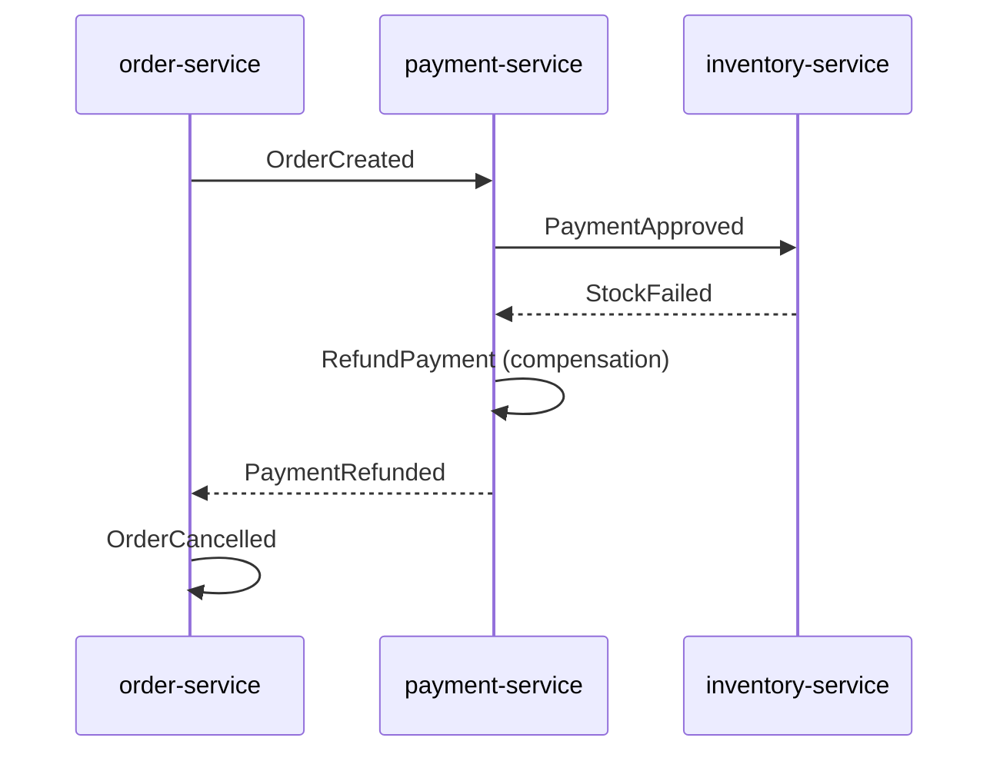

# Order Saga Lab

An event-driven order processing lab built to practice and demonstrate modern backend engineering: hexagonal architecture, microservices, Kafka and RabbitMQ messaging, sagas, CQRS and event sourcing, on top of Kotlin, Java and Spring Boot, with CI/CD, containers and cloud infrastructure as code.

> **Status: work in progress.** This is a learning lab, not production-ready software. This README only describes what already exists in the repository; planned work is tracked in the [Status](#status) section.

## Overview

The domain is intentionally simple (order → payment → inventory → notification), so the focus stays on architecture and engineering practices rather than business rules. Each service is independently buildable and deployable, even though everything lives in a single repository (see [ADR-0001](DECISIONS.md)).

## Target architecture (planned)

| Service | Stack | Role |
|---|---|---|
| `order-service` | Kotlin, Spring Boot | Hexagonal architecture, Postgres, publishes events to Kafka, event-sourced `Order` aggregate |
| `payment-service` | Kotlin, Ktor, Exposed, Koin | Consumes `OrderCreated`, processes payment, publishes the result |
| `inventory-service` | Java 25, Spring Boot | Reserves stock, uses RabbitMQ with dead-letter queues |
| `order-query-service` | Kotlin or Java | CQRS read model built from events |
| `bff-web` | Spring Boot or Ktor | Backend for frontend, aggregates data for a fictional client |
| `gateway` | Spring Cloud Gateway | Single entry point, JWT validation, rate limiting |
| `notifier` | Go | Lightweight event consumer that "sends" notifications |

Choreographed saga, with compensation when a step fails:



## Tech stack (planned)

- **Languages and frameworks:** Kotlin, Java 25 (LTS), Spring Boot 4.1, Spring Cloud, Ktor, Exposed, Koin, Go
- **Messaging:** Apache Kafka, RabbitMQ
- **Data:** PostgreSQL
- **Testing:** JUnit 5, Mockito/MockK, Testcontainers, TDD
- **Containers and orchestration:** Docker, Kubernetes (kind)
- **CI/CD:** Jenkins, Maven
- **Cloud and IaC:** AWS (VPC, IAM, S3, RDS, ECS, Lambda, API Gateway), Terraform
- **Observability and security:** Prometheus, Grafana, ELK, Keycloak, OWASP Dependency-Check

## Getting started

Prerequisite: a JDK 25. Maven is not required, each service ships with the Maven Wrapper.

Run the `order-service` skeleton (it currently exposes only the Actuator endpoints):

```bash
cd order-service
./mvnw spring-boot:run
curl localhost:8080/actuator/health   # {"status":"UP", ...}
```

Build and run the tests (domain unit tests and the architecture rules):

```bash
./mvnw verify
```

Instructions for the other services will be added as each one lands.

## Repository structure

```text
order-saga-lab/
├── README.md
├── DECISIONS.md      # architecture decision records (ADRs)
├── LICENSE
├── .gitignore
└── order-service/    # Kotlin + Spring Boot
    └── src/main/kotlin/io/github/willsilva2/ordersagalab/order/
        ├── domain/        # Order, OrderItem, OrderStatus, InvalidOrderException
        ├── application/   # ports (inbound, outbound) and services, still empty
        ├── adapter/       # inbound (web) and outbound (persistence), still empty
        └── config/        # wiring, still empty
```

The hexagonal rules are enforced by an ArchUnit test (`ArchitectureTest`), see [ADR-0005](DECISIONS.md).

The other services, `infra/` and `docs/` will be added as the lab progresses.

## Status

- [ ] Phase 1: Foundation and hexagonal architecture (in progress: package structure, `Order` domain model built with TDD and architecture tests are done)
- [ ] Phase 2: Tests (TDD, JUnit, Testcontainers)
- [ ] Phase 3: Ktor, Exposed, Koin and Java 25
- [ ] Phase 4: Messaging and event-driven patterns
- [ ] Phase 5: Spring Cloud, BFF and resilience
- [ ] Phase 6: Docker and Kubernetes
- [ ] Phase 7: CI/CD with Jenkins
- [ ] Phase 8: AWS and Terraform
- [ ] Phase 9: Observability and security
- [ ] Phase 10: Go notifier

## Architecture decisions

Decisions and their trade-offs are recorded in [DECISIONS.md](DECISIONS.md).

## License

Released under the [MIT License](LICENSE).